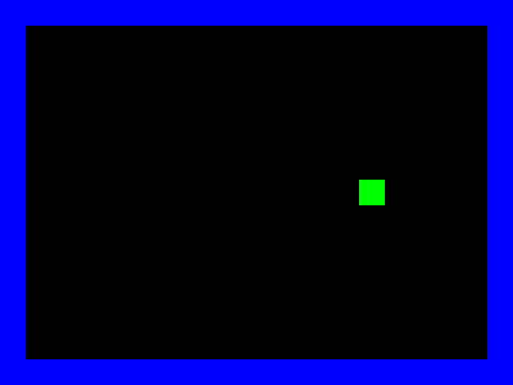

# Verilog Snake

A Snake game built from scratch in Verilog, simulated with Icarus Verilog. The long-term goal is to build a small RISC-V CPU on top of what I learn here.

**Status:** in progress. The VGA pipeline, game grid, tick timer, and snake head movement are done and verified. Everything is verified in simulation only, with no FPGA hardware yet.

## What's done

- [x] VGA sync generator (640x480 @ 60 Hz) with a self-checking testbench
- [x] Pixel generator and top-level module
- [x] 20x15 game grid with border
- [x] Game tick timer
- [x] Snake head movement
- [ ] Snake body storage
- [ ] Food (LFSR), growth, and collisions
- [ ] Game state machine and score display

## VGA timing

The monitor needs sync pulses to know where each line and frame starts. A counter pair generates them from a 25 MHz pixel clock:

| | Visible | Front porch | Sync | Back porch | Total |
|---|---|---|---|---|---|
| Horizontal | 640 | 16 | 96 | 48 | 800 |
| Vertical | 480 | 10 | 2 | 33 | 525 |

Both sync signals are active low.


The testbench checks that `hsync` is low for 96 clocks per line, `vsync` is low for 1600 clocks per frame (2 lines), and `active` is high for 640 x 480 = 307200 clocks per frame.

## Snake head movement

The screen is a 20x15 grid of 32x32-pixel cells. A game tick pulses about 8 times per second, and on each tick the snake head moves one cell in its current direction. Frame 0 (left) and frame 4 (right), moving right:




## Run it

Requires [Icarus Verilog](https://bleyer.org/icarus/) and GTKWave. Run each one on its own from the project folder and look for `PASS`.

VGA sync generator:
```
iverilog -o sim rtl/vga_sync.v tb/vga_sync_tb.v
vvp sim
```

Pixel generator:
```
iverilog -o sim rtl/pixel_gen.v tb/pixel_gen_tb.v
vvp sim
```

Game tick:
```
iverilog -o sim rtl/game_tick.v tb/game_tick_tb.v
vvp sim
```

Snake head:
```
iverilog -o sim rtl/snake_head.v tb/snake_head_tb.v
vvp sim
```

Whole design (top level):
```
iverilog -o sim rtl/vga_sync.v rtl/game_tick.v rtl/snake_head.v rtl/pixel_gen.v rtl/vga_top.v tb/vga_top_tb.v
vvp sim
```

## Layout

```
rtl/    Verilog design files
tb/     Testbenches
docs/   Diagrams, waveform screenshots, rendered frames
```