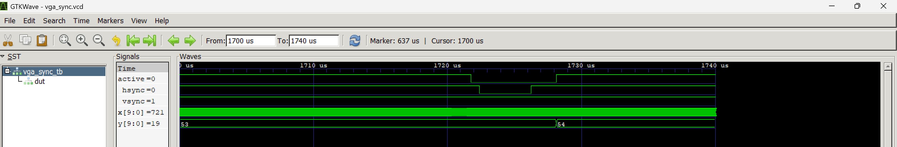
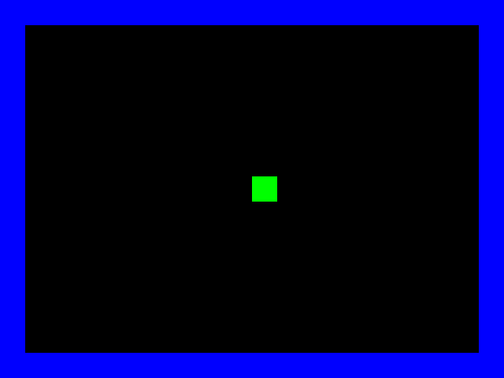
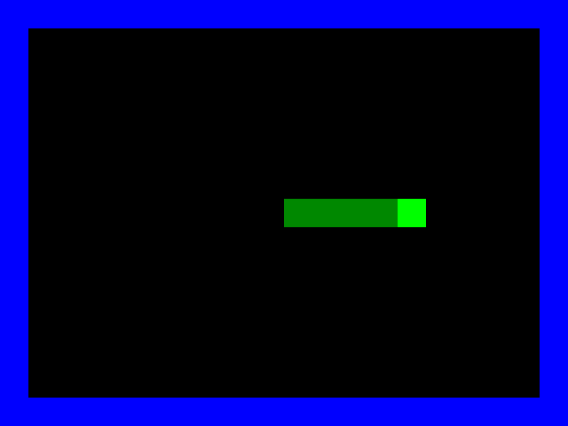
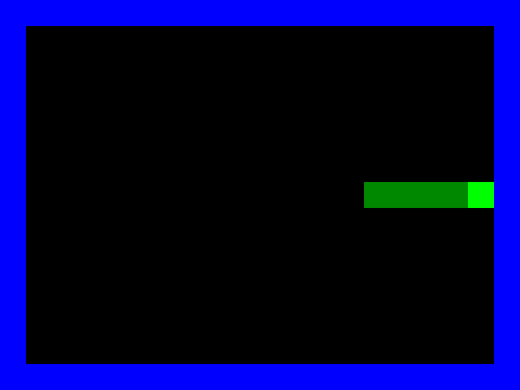
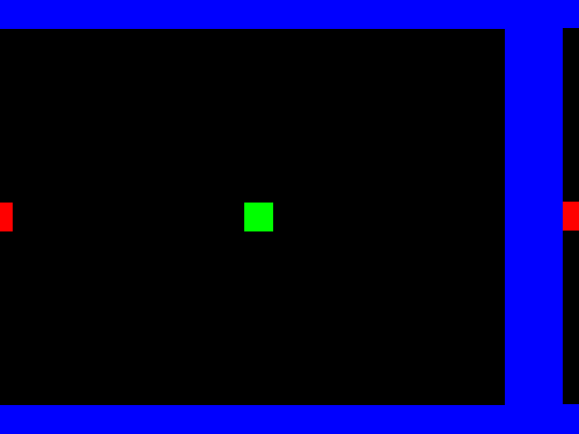
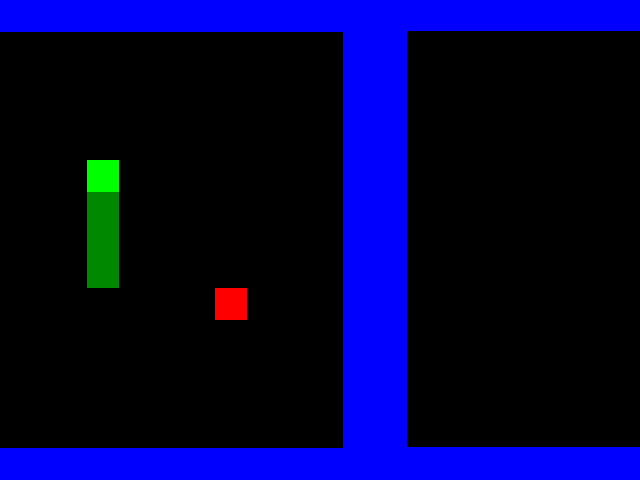
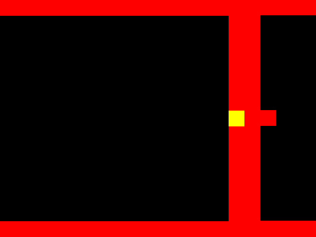
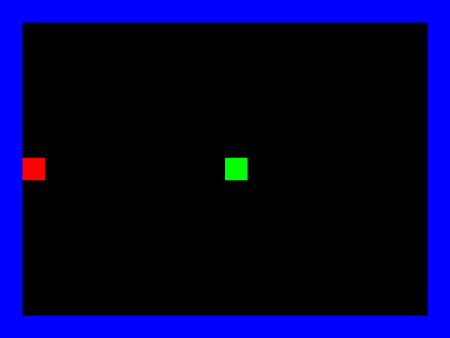
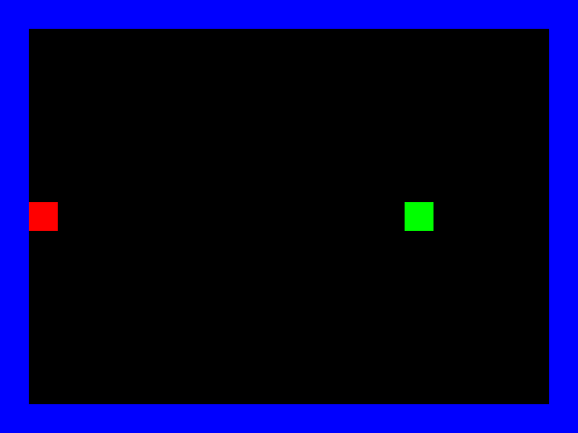

# Verilog Snake

A Snake game built from scratch in Verilog. It is verified with self-checking testbenches in Icarus Verilog, and it is playable with the keyboard through a Verilator + SDL2 front end. The long-term goal is to build a small RISC-V CPU on top of what I learn here.

**Status:** complete in simulation. Video output, grid, movement, growth, food, collisions, game over, restart, button direction input, and a seven-segment score display all work and are tested. The same Verilog also runs in Verilator, where it is checked against the VGA timing spec for whole frames and can be played live in a window. There is no FPGA hardware yet.

## What's done

- [x] VGA sync generator (640x480 @ 60 Hz) with a self-checking testbench
- [x] Pixel generator and top-level module
- [x] 20x15 game grid with border
- [x] Game tick timer
- [x] Snake head movement
- [x] Snake occupancy map (one bit per cell)
- [x] Snake body storage (position queue with growth)
- [x] Food (LFSR-placed) and eating
- [x] Collisions and game-over state machine
- [x] Direction input (ignore U-turns)
- [x] Score display (seven-segment)
- [x] Interactive window (play with the keyboard)

## VGA timing

The monitor needs sync pulses to know where each line and frame starts. A counter pair generates them from a 25 MHz pixel clock:

| | Visible | Front porch | Sync | Back porch | Total |
|---|---|---|---|---|---|
| Horizontal | 640 | 16 | 96 | 48 | 800 |
| Vertical | 480 | 10 | 2 | 33 | 525 |

Both sync signals are active low.



The testbench checks that `hsync` is low for 96 clocks per line, `vsync` is low for 1600 clocks per frame (2 lines), and `active` is high for 640 x 480 = 307200 clocks per frame.

## How the game works

The screen is a 20x15 grid of 32x32-pixel cells. A tick generator pulses about 8 times per second. On each tick:

1. The snake head moves one cell in its current direction.
2. The new head cell is added to a position queue and marked in a 300-bit occupancy map.
3. Unless the snake is growing, the oldest cell (the tail) is removed from the queue and cleared from the map.

The pixel generator asks the map whether each pixel's cell is occupied, so drawing the snake is a single lookup per pixel instead of comparing against every segment.

Food is placed by a 16-bit LFSR (a small pseudo-random generator). A candidate cell is accepted only if it is inside the border and not on the snake. When the head reaches the food, the snake grows on its next move.

## Rules

The game ends when the head enters a border cell or a cell already occupied by the snake's own body. Moving into the cell the tail is leaving on the same move is allowed. When the game is over, the snake freezes and the border turns red. A restart input resets the game logic (timer, snake, map, food) but keeps the video timing and the random generator running, so each new game gets different food.

## Direction input

Four buttons steer the snake. `dir_ctrl` handles three things:

- **Synchronizer.** Each button goes through two flip-flops so an asynchronous press can't glitch the logic.
- **No U-turns.** A request opposite to the direction the snake last moved is ignored. With the encoding 0 up, 1 right, 2 down, 3 left, the opposite of `d` is `d ^ 2'b10`.
- **Fast double presses.** The controller keeps `dir_cur` (the last move) and `dir_next` (the request), and checks new requests against the right one, including on the exact clock edge a tick fires. This stops two quick presses from sneaking in a reversal.

`snake_top` wraps `dir_ctrl` and the game core, and is the module that would map onto a board's pins.

## Score display

The snake's length is shown as a decimal number on three seven-segment digits, active-low like the DE2 board's displays. `seg7` is the digit decoder, and `score_display` splits the number into digits and blanks leading zeros (so 7 shows as 7, not 007).

## Snake movement and growth

The snake grows for the first four moves, then just crawls. Frames 0, 4, and 8, moving right (bright green is the head):





## Food

An autopilot in the testbench steers toward the food until the snake has eaten three pieces. Start (left) and end (right); food is the red cell:




## Game over

The snake hit the wall: it freezes, and the border turns red.



## Verilator and the live window

Icarus is an interpreter and is too slow to run a whole game in real time. Verilator translates the Verilog into C++ instead, so the design becomes a fast C++ model driven by my own code.

- `verilator/sim_main.cpp` runs 31 full frames (13 million clock cycles), checks `hsync` and `vsync` against the VGA timing on every cycle, and writes frames 0 and 30 as images. It reports zero sync mismatches.
- `verilator/play_main.cpp` opens an SDL2 window, maps the arrow keys / WASD to the four button inputs and R to restart, and shows the score by decoding the three seven-segment output pins in C++. Key-down events are latched so a quick tap is never missed.

Simulated time is slower than real hardware time, so the game's tick divider is set from the measured frame rate: `TICK_DIV` of about `fps x 52500` gives 8 moves per second.

Frames rendered by the Verilator model (start and 30 frames in):




## Run it

The Icarus tests need [Icarus Verilog](https://bleyer.org/icarus/) and GTKWave. Run each one on its own from the project folder and look for `PASS`.

VGA sync generator:
```
iverilog -o sim rtl/vga_sync.v tb/vga_sync_tb.v
vvp sim
```

Pixel generator:
```
iverilog -o sim rtl/pixel_gen.v tb/pixel_gen_tb.v
vvp sim
```

Game tick:
```
iverilog -o sim rtl/game_tick.v tb/game_tick_tb.v
vvp sim
```

Snake head:
```
iverilog -o sim rtl/snake_head.v tb/snake_head_tb.v
vvp sim
```

Snake occupancy map:
```
iverilog -o sim rtl/snake_map.v tb/snake_map_tb.v
vvp sim
```

Snake body queue (uses the map):
```
iverilog -o sim rtl/snake_map.v rtl/snake_body.v tb/snake_body_tb.v
vvp sim
```

LFSR (pseudo-random numbers, used for food placement):
```
iverilog -o sim rtl/lfsr16.v tb/lfsr16_tb.v
vvp sim
```

Food controller (uses the LFSR and the map):
```
iverilog -o sim rtl/lfsr16.v rtl/snake_map.v rtl/food_ctrl.v tb/food_ctrl_tb.v
vvp sim
```

Game controller (collisions and game over):
```
iverilog -o sim rtl/game_ctrl.v tb/game_ctrl_tb.v
vvp sim
```

Direction controller (U-turn protection, double presses, tick-edge race):
```
iverilog -o sim rtl/dir_ctrl.v tb/dir_ctrl_tb.v
vvp sim
```

Seven-segment decoder and score display:
```
iverilog -o sim rtl/seg7.v rtl/score_display.v tb/score_display_tb.v
vvp sim
```

Whole design (top level):
```
iverilog -o sim rtl/vga_sync.v rtl/game_tick.v rtl/snake_head.v rtl/snake_map.v rtl/snake_body.v rtl/lfsr16.v rtl/food_ctrl.v rtl/game_ctrl.v rtl/pixel_gen.v rtl/vga_top.v tb/vga_top_tb.v
vvp sim
```

Game over and restart (drives the snake into the wall, checks it freezes, then restarts):
```
iverilog -o sim rtl/vga_sync.v rtl/game_tick.v rtl/snake_head.v rtl/snake_map.v rtl/snake_body.v rtl/lfsr16.v rtl/food_ctrl.v rtl/game_ctrl.v rtl/pixel_gen.v rtl/vga_top.v tb/gameover_tb.v
vvp sim
```

Full game with buttons (steers with button presses only and checks the U-turn rule end to end):
```
iverilog -o sim rtl/vga_sync.v rtl/game_tick.v rtl/snake_head.v rtl/snake_map.v rtl/snake_body.v rtl/lfsr16.v rtl/food_ctrl.v rtl/game_ctrl.v rtl/pixel_gen.v rtl/vga_top.v rtl/dir_ctrl.v rtl/seg7.v rtl/score_display.v rtl/snake_top.v tb/snake_top_tb.v
vvp sim
```

### Verilator

Needs Verilator 5, a C++ toolchain, and SDL2 (`sudo apt install verilator build-essential libsdl2-dev`). On Windows, run these inside WSL.

Whole-game frame check (prints `sync mismatches: 0` and writes `vframe0.ppm` and `vframe30.ppm`):
```
verilator --cc --exe --build -j 0 -Wno-fatal --top-module snake_top --Mdir verilator/obj_dir rtl/*.v verilator/sim_main.cpp
./verilator/obj_dir/Vsnake_top
```

Play it (arrow keys or WASD steer, R restarts, Esc quits):
```
mkdir -p verilator/play
verilator --cc --exe --build -j 0 -Wno-fatal -O3 --top-module snake_top -GTICK_DIV=1500000 --Mdir verilator/play/obj_dir -CFLAGS "-O3 $(sdl2-config --cflags)" -LDFLAGS "$(sdl2-config --libs)" rtl/*.v verilator/play_main.cpp
./verilator/play/obj_dir/Vsnake_top
```

## Render frames

The demo testbenches write frames as PPM images, and a small Python script converts them to PNG (needs `pip install pillow`). The commands below all use the same ten design files.

Snake growth (frames 0, 4, 8):
```
iverilog -o sim rtl/vga_sync.v rtl/game_tick.v rtl/snake_head.v rtl/snake_map.v rtl/snake_body.v rtl/lfsr16.v rtl/food_ctrl.v rtl/game_ctrl.v rtl/pixel_gen.v rtl/vga_top.v tb/snake_dump_tb.v
vvp sim
python -c "from PIL import Image; [Image.open(f'snake{n}.ppm').save(f'docs/snake{n}.png') for n in (0,4,8)]"
```

Autoplay food demo:
```
iverilog -o sim rtl/vga_sync.v rtl/game_tick.v rtl/snake_head.v rtl/snake_map.v rtl/snake_body.v rtl/lfsr16.v rtl/food_ctrl.v rtl/game_ctrl.v rtl/pixel_gen.v rtl/vga_top.v tb/autoplay_dump_tb.v
vvp sim
python -c "from PIL import Image; [Image.open(f'food_{n}.ppm').save(f'docs/food_{n}.png') for n in ('start','end')]"
```

Game over frame:
```
iverilog -o sim rtl/vga_sync.v rtl/game_tick.v rtl/snake_head.v rtl/snake_map.v rtl/snake_body.v rtl/lfsr16.v rtl/food_ctrl.v rtl/game_ctrl.v rtl/pixel_gen.v rtl/vga_top.v tb/gameover_tb.v
vvp sim
python -c "from PIL import Image; Image.open('gameover.ppm').save('docs/gameover.png')"
```

Verilator frames (after running the Verilator frame check above):
```
python -c "from PIL import Image; [Image.open(f'vframe{n}.ppm').save(f'docs/vframe{n}.png') for n in (0,30)]"
```

## Layout

```
rtl/        Verilog design files
tb/         Icarus testbenches
verilator/  C++ testbench and the SDL2 player
docs/       Diagrams, waveform screenshots, rendered frames
```